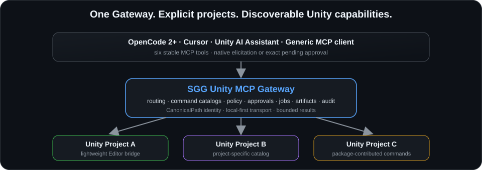

<div align="center">

# SGG Unity MCP Gateway

**One local MCP connection for safe AI-assisted work across multiple Unity projects.**

[English](./README.md) |
[Русский](./README.ru.md)

—

[Installation](./docs/en/installation.md) |
[Quick Start](./docs/en/quick-start.md) |
[OpenCode](./docs/en/connect/opencode.md) |
[Workflows](./docs/en/guides/workflows.md) |
[Extend Your Asset](./docs/en/extensions/quick-start.md) |
[Reference](./docs/en/reference/commands.md) |
[Troubleshooting](./docs/en/troubleshooting.md) |
[Changelog](./CHANGELOG.md)

<p>
  <a href="./docs/en/installation.md"></a>
  <a href="./docs/en/guides/multi-project.md"></a>
  <a href="./docs/en/connect/opencode.md"></a>
  <a href="./docs/en/connect/windows-wsl.md"></a>
  <a href="./docs/en/guides/permissions.md"></a>
  <a href="./docs/en/extensions/quick-start.md"></a>
</p>

<p>
  <a href="./docs/en/reference/architecture.md"></a>
</p>

</div>

SGG Unity MCP Gateway connects OpenCode, Cursor, Unity AI Assistant, and other MCP clients to several local Unity Editor projects through one Gateway. Every Unity operation targets an explicit project, capabilities are discovered just in time, and risky commands stay behind local feature flags, policy, and human approval.

## What Problem It Solves

| Common Unity MCP problem | SGG approach |
| --- | --- |
| An implicit active Editor becomes ambiguous when several Unity projects are open. | Every Unity call includes an explicit `project`; one Gateway routes to multiple live Editor bridges. |
| Dozens or hundreds of top-level tools permanently consume model context. | The public MCP surface stays at eight stable tools; Unity capabilities are discovered from each project's command catalog. |
| Windows, WSL, and Unity spell the same project path differently. | CanonicalPath provides deterministic lexical identity for routing and cache keys; PathGuard remains the Unity-side access boundary. |
| A coding agent should not receive ambient write, execute, network, or destructive authority. | Feature flags control visibility; policy chooses `allow`, `ask`, or `deny`; approvals are bound to one exact request. |
| Asset authors want agent APIs without maintaining another MCP server. | Unity packages contribute catalog commands through C# handlers or `mcp.commands.json`; agents still use the same eight tools. |

## How It Works

```text
OpenCode / Cursor / Unity AI Assistant / another MCP client
                              │
                    eight stable MCP tools
                              ▼
                   SGG Unity MCP Gateway
                     │        │        │
                     ▼        ▼        ▼
                 Project A  Project B  Project C
                 Unity      Unity      Unity
                 Bridge     Bridge     Bridge
```

Core rules:

```text
1. There is no global active Unity project.
2. Every Unity command call includes an explicit project.
3. Project capabilities are discovered with sgg_unity_describe.
4. Unity/package commands are catalog entries invoked through sgg_unity_call.
5. Agent payload paths use Assets/... or Packages/..., not arbitrary absolute paths.
6. One local Gateway can serve all open projects.
```

## Quick Start

1. Install the Unity package from a pinned Git UPM tag or a local checkout.
2. Open `SGG/Unity MCP/MCP Window`, complete the required Setup actions, and make Gateway Health green.
3. Copy the configuration for OpenCode, Cursor, Unity AI Assistant, or another MCP client.
4. Run the safe first sequence:

```text
sgg_unity_projects
sgg_unity_describe(project="<project-id>", selector="commands")
sgg_unity_call(
  project="<project-id>",
  command="compile.status",
  args_json="{}",
  mode="wait"
)
```

Pinned Git UPM shape:

```json
{
  "dependencies": {
    "com.sungeargames.unity-mcp": "https://github.com/romanilyin/sgg-unity-mcp-gateway.git?path=/unity/Packages/com.sungeargames.unity-mcp#2026.10.12-2"
  }
}
```

During pre-release development, a local file dependency is also supported. See [Installation](./docs/en/installation.md) for CanonicalPath setup, updates, removal, local checkout mode, and the normal portable-runtime flow.

CanonicalPath is a required project dependency installed from the public scoped registry by the host project.

## Common Workflows

- **Compile and Console diagnosis** — inspect compilation state and bounded Editor logs without changing the project.
- **Scene, prefab, asset, and reference inspection** — use semantic commands before reading raw Unity YAML.
- **Reviewed project edits** — run a read-only risk report or dry run, then let policy and approval gate the exact write.
- **Tests and builds** — start bounded operations, poll status, and read large output through project-local artifacts.
- **Several projects at once** — select an explicit project or instance for every call; different project queues can run concurrently.
- **Package-contributed commands** — install an asset package and discover its command set from that project's catalog.

Copy-paste flows and natural-language request examples are in [Workflows](./docs/en/guides/workflows.md).

## Build Agent APIs For Your Unity Assets

A Unity asset or tool package can expose an agent-facing API without starting a second MCP server.

```text
com.example.my-asset
  ├─ Editor/Mcp/mcp.commands.json
  │     dependency-free manifest registration
  └─ [McpCommand] C# Editor handlers
        direct bridge API integration
                 │
                 ▼
       project command catalog
                 │
                 ▼
      sgg_unity_call + args_json
```

Package commands do not become new top-level MCP tools. The Gateway applies the same schema validation, output limits, feature flags, package trust, policy, approval, and audit controls.

Start with [Add MCP Support To Your Asset](./docs/en/extensions/quick-start.md).

## Safety By Default

The normal deployment is local-first:

- the Gateway binds to `127.0.0.1` by default;
- a local token is supported and required before intentional non-loopback access;
- commands carry `read`, `write`, `execute`, `destructive`, or `network` risk;
- feature flags make command families visible, while policy independently decides `allow`, `ask`, or `deny`;
- an agent cannot approve its own `ask`-gated request;
- clients that advertise and render MCP form elicitation can display the Gateway's native prompt;
- OpenCode v2 implements forms; the updated shim relays them capability-aware. Actual OpenCode/OpenChamber frontend/human acceptance requires separate evidence;
- dynamic C# execution is advanced local automation, not a sandbox.

Read [Permissions And Approvals](./docs/en/guides/permissions.md) and [Security](./docs/en/reference/security.md) before enabling broad write, execute, network, or destructive access.

## Requirements And Current Support

| Area | Current contract |
| --- | --- |
| Unity host | Windows is the normal supported host for Unity Editor and the Gateway. |
| Unity version | Unity `6000.4+` is the recommended development baseline. The package metadata keeps `2022.3` as an import/compile floor; release support must follow recorded validation evidence. |
| Render pipeline | The Gateway architecture is independent of Built-in, URP, or HDRP. Individual package-contributed commands may have their own requirements. |
| MCP clients | OpenCode is the primary documented path. Cursor, Unity AI Assistant, and generic stdio/remote HTTP clients are also covered. |
| MCP protocol | Direct HTTP and direct stdio support modern `2026-07-28` plus legacy MCP 2025. The HTTP-to-stdio shim is legacy-only. |
| OpenCode v2 elicitation | Forms are implemented; advertised/rendered connection capability and actual human UI acceptance are authoritative. OpenChamber requires its own evidence. |
| Node.js | Normal setup installs a private portable Node runtime. A system-wide Node installation is not required. |
| WSL | OpenCode in WSL is supported; the Windows stdio shim is the recommended same-machine connection mode. |
| Deployment | Local-first. No hosted runner, cloud project hosting, OAuth, JWT, SSO, or enterprise identity layer is claimed. |

## Documentation

**Start**

- [Documentation index](./docs/en/README.md)
- [Quick Start](./docs/en/quick-start.md)
- [Installation](./docs/en/installation.md)
- [Troubleshooting](./docs/en/troubleshooting.md)

**Connect**

- [OpenCode](./docs/en/connect/opencode.md)
- [Cursor](./docs/en/connect/cursor.md)
- [Unity AI Assistant](./docs/en/connect/unity-ai-assistant.md)
- [Generic stdio clients](./docs/en/connect/generic-stdio.md)
- [Windows and WSL](./docs/en/connect/windows-wsl.md)

**Use**

- [Common workflows](./docs/en/guides/workflows.md)
- [Permissions and approvals](./docs/en/guides/permissions.md)
- [Multi-project routing](./docs/en/guides/multi-project.md)
- [Jobs and artifacts](./docs/en/guides/jobs-and-artifacts.md)
- [Diagnostics](./docs/en/guides/diagnostics.md)
- [Canvas/uGUI to UI Toolkit migration](./docs/en/guides/canvas-to-uitk.md)

**Extend**

- [Extension quick start](./docs/en/extensions/quick-start.md)
- [Command manifests](./docs/en/extensions/command-manifest.md)
- [C# handlers](./docs/en/extensions/csharp-handlers.md)
- [Extension governance](./docs/en/extensions/governance.md)
- [Extension testing](./docs/en/extensions/testing.md)

**Reference**

- [Architecture](./docs/en/reference/architecture.md)
- [MCP tools](./docs/en/reference/mcp-tools.md)
- [Command catalog](./docs/en/reference/commands.md)
- [Configuration](./docs/en/reference/configuration.md)
- [Policy](./docs/en/reference/policy.md)
- [Error codes](./docs/en/reference/error-codes.md)
- [Compatibility](./docs/en/reference/compatibility.md)
- [Security](./docs/en/reference/security.md)
- [License FAQ](./docs/en/reference/license.md)
- [Comparison](./docs/en/comparison.md)
- [Limitations](./docs/en/limitations.md)

## Known Limitations

- This is not an official Unity product.
- The documented baseline is local-first; there is no hosted or managed runner.
- Different open projects may use different package/runtime versions. Check Setup Health and version diagnostics instead of assuming cross-version compatibility.
- Checkpoints cover bounded project-local files, not complete Unity project or Editor state.
- Profiler and UI migration capabilities are command-family specific; discover the current catalog before assuming a command exists.
- Native elicitation depends on the MCP client advertising and rendering the capability. The pending approval workflow remains the compatibility path.

## Versioning

Installable builds use calendar build versions in SemVer-compatible form:

```text
YYYY.M.D-N
```

See [Versioning](./docs/en/maintainers/versioning.md).

## License

This project is licensed under **Stinger Royalty-Free EULA 1.0**.

- Authoritative Russian text: [LICENSE.ru.md](./LICENSE.ru.md)
- English convenience translation: [LICENSE.md](./LICENSE.md)
- Notices: [NOTICE.md](./NOTICE.md)
- Practical summary: [License FAQ](./docs/en/reference/license.md)
