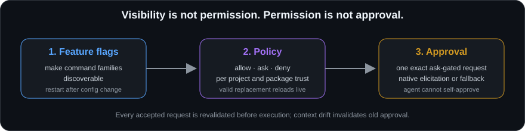

[English](./permissions.md) | [Русский](../../ru/guides/permissions.md)

# Permissions And Approvals


Gateway access is intentionally split into three independent layers.

<p align="center">
  
</p>

## The Three Layers

### 1. Feature Flags

A feature flag makes a command family visible in the selected project's catalog.

```text
feature disabled -> command is not discoverable
feature enabled  -> command can be considered by policy
```

Enabling a feature does not grant permission.

### 2. Policy

Policy resolves each command to:

```text
allow
ask
deny
```

It uses:

- command-specific allow/ask/deny patterns;
- risk defaults;
- project id;
- package trust for extension commands.

A policy change does not enable a hidden feature family.

### 3. Approval

Approval applies only when the current policy decision is `ask`.

It is bound to one exact resolved request. It is not a reusable permission, a project-wide allow rule, or an argument hash chosen by the agent.

## Recommended Profiles

| Profile | Use it for | Typical behavior |
| --- | --- | --- |
| Read-only | First smoke test and basic status. | Compile, logs, package reads, loaded scenes, safe discovery. Too limited for normal work. |
| Inspect | Understanding scenes, prefabs, assets, scripts, APIs, docs, and read-only profiler state. | Read-heavy feature families enabled; mutation remains blocked or ask-gated. |
| Safe Writes | Reviewed local scene/object/asset/script edits. | Read preflight allowed; exact writes remain `ask`. |
| Test Validation | Bounded Unity test execution and evidence. | Status/list reads allowed; refresh/validation/test execution remains `ask`. |
| Package Management | Package reads and controlled install/update/remove. | Reads allowed; write/network operations remain `ask` or denied. |
| Runtime Debug | Bounded Play Mode snapshots and temporal debugging. | Reads allowed; state changes and long sampling remain gated. |
| Allow All | Fully trusted local project only. | Removes project policy ask gates for visible built-in/trusted commands. Not recommended as a default. |

Use `Permissions -> Apply + Enable Flags` to update both the profile and its matching feature flags. Feature and other config changes require a Gateway restart; valid policy replacements are reloaded between calls. On runtimes supporting live popup settings, the only live Gateway config exception is the owner-saved `approvals.auto_allow_known_unity_popups` boolean, described below.

## Safe Default Risk Posture

```text
read         allow
write        ask
execute      deny
destructive  ask
network      deny
```

Project-specific command rules can be narrower than these defaults. Deny remains the safest response when the workflow is not explicitly needed.

## Native MCP Elicitation

Interactive approval has two protocol forms. Modern MCP `2026-07-28` uses a multi-round-trip `input_required` result and a signed opaque `requestState`; legacy MCP 2025 uses form elicitation when advertised. OpenCode product version alone does not determine the protocol era.

Native flow:

```text
1. Agent calls an ask-gated command.
2. Gateway resolves project, descriptor, feature, schema, and policy.
3. Gateway writes a bounded pending identity and requests input through modern MRTR or legacy form elicitation.
4. OpenCode shows Accept / Decline / Cancel.
5. On Accept, Gateway reloads and revalidates the full request context.
6. The exact call executes at most once.
```

The form uses a simple approval field and safe request metadata. It must not request tokens, credentials, raw arguments, local paths, or secret binding material.

Modern `requestState` contains only bounded correlation metadata and is HMAC verified before handler re-entry. It is not proof that the user consented; only a validated `accept` response followed by the existing one-shot pending-generation claim can authorize execution.

### What Accept Does Not Mean

Accept does not:

- change the project policy;
- approve future calls;
- enable feature flags;
- authorize another project;
- authorize a changed command or changed arguments;
- disable audit;
- make a denied command executable.

### Context Drift

If project instance, catalog descriptor, policy, feature state, schema, or exact request binding changed while the prompt was open, the accepted generation is invalidated. The Gateway returns the current safe error or a fresh approval request rather than reviving the old one.

## Pending-Approval Fallback

Clients without MCP elicitation receive:

```text
status: error
error.code: confirmation_required
details.approval_request
details.approval_workflow
```

Review pending requests from a trusted local terminal:

```text
sgg-unity-mcp-gateway approval pending --dir "%LOCALAPPDATA%/SGG/UnityMcpGateway/approvals" --project <project-id>
```

Approve one exact pending id:

```text
sgg-unity-mcp-gateway approval approve --dir "%LOCALAPPDATA%/SGG/UnityMcpGateway/approvals" --pending-id <pending-id>
```

Then retry the original MCP call unchanged.

Approving creates a one-shot authorization record; it does not execute the command. The original call must be repeated explicitly.

## Unity Window

Use:

```text
SGG/Unity MCP/MCP Window -> Permissions
```

The page can:

- show the current `Project Id`;
- apply known profiles;
- enable matching feature flags;
- display current project allow/ask/deny rules;
- preview the catalog by policy bucket;
- edit only the current project's command pattern lists after explicit review;
- show pending approval information without becoming an MCP self-approval tool.

Feature flags, risk defaults, approvals, and command execution remain separate concerns.

## Policy Precedence

Practical decision order:

```text
project and command must resolve
feature must be enabled
arguments must match schema
package trust must permit consideration
explicit deny wins
explicit ask/allow patterns apply
risk default fills the remaining case
ask requires one exact approval
```

Policy evaluation details are available through `policy.explain` when the feature and read permission are enabled. It never executes the target command or consumes an approval.

## Extension Package Trust

A package cannot mark itself trusted.

| Source | Trust state | Effect |
| --- | --- | --- |
| Built-in Gateway/Bridge command | `builtin` | Normal feature/policy/approval checks. |
| Command from a configured trusted package id | `trusted_package` | Normal project rules can apply. |
| Command from another package | `untrusted_package` | `untrusted_package_default` gates it before project allow patterns can auto-allow it. |

Use `ask` or `deny` as the untrusted default.

## Temporary `auto_allow_ask`

`approvals.auto_allow_ask: true` exists for trusted local compatibility sessions.

It does not bypass:

```text
deny
feature flags
schema validation
project resolution
package trust
Unity-relative path checks
PathGuard
```

Every auto-allowed call is marked in audit.

Do not present this as the primary path. Disable it as soon as native elicitation or the pending workflow is practical.

The separate `approvals.auto_allow_stale_registry_cleanup_without_elicitation` default is deliberately narrower: it applies only to exact precondition-bound dead-record cleanup on a connection without form elicitation. It does not change any Unity command policy and capable connections remain ask-gated.

## Owner-preapproved known Unity popups

MCP Window → Permissions → One-shot Approvals includes **Do not ask again for known Unity popups**, backed by `approvals.auto_allow_known_unity_popups`. It is **off by default**. Enabling it shows a warning that the owner can cancel. On Gateway runtimes supporting file-backed live popup settings, saved enable/disable changes apply on the next request **without restart**; the setting is rechecked before a real built-in response is issued, including revocation. Saving the checkbox does not submit a response or replay a blocked call. It does not change `auto_allow_ask`, profiles or policy rules.

Only this boolean is reread from the original config file. The Gateway requires a stable, bounded read (at most 1 MiB), strict validation of the full config, and rejection of duplicate JSON keys. Missing, unreadable, invalid, oversized or unstable config disables the opt-in fail-closed; a previous `true` is not retained. All other feature flags, approval settings/key/directories, token and network settings remain startup-bound and require restart to change.

The owner delegates choice of supported replies, including Save/Don't Save/Cancel, Reload/Ignore, project downgrade Continue, scoped-registry Close, Enter Safe Mode and **Keep Backups** in the exact **Scene Backup Detected** dialog. This can discard unsaved changes or change project state. The checkbox only removes the extra approval question: policy `deny`, feature/trust/schema checks, exact owner/process/window evidence, dry-run plans, confirm arguments and single-use/no-replay protections remain. Unknown windows, generic recovery commands, crash-reporter/process termination and ordinary writes/builds are not included. A sent message never proves popup closure or project recovery.

`diagnostics.unity_scene_backup.keep_backups` defaults to dry-run. Use one current PID/process-start/canonical-root binding and the returned 60-second single-use plan; real submission requires `dry_run:false`, `confirm_keep_backups:true` and the exact `precondition_hash`. A restarted Editor blocked before its first heartbeat is eligible only after a fresh, complete process scan binds one known project root. **Delete** and legacy **Recovering Scene Backups** Yes/No responses are never supported. An uncertain native attempt suppresses another response to the same popup; never replay the blocked compile/test/package operation.

`diagnostics.status` and `diagnostics.unity_modal.status` expose the running `popup_response_approval` state and exact supported command IDs. Check `enabled`, not just the saved checkbox. File-backed contexts may additionally report `application_mode:live_on_request`, `source_status`, `saved_enabled` and `restart_required:false`; older runtimes may omit these fields. When the running state is enabled and all exact command checks pass, an agent may issue a supported response without a new approval UI; `confirmation_required` still requires the normal human workflow. Auto-allowed responses record `approval_status:auto_allowed` and `auto_allow_known_unity_popups:true` in audit. Agents must not activate the setting themselves or substitute broader commands for refusals.

## Common Errors

| Error | Meaning | Response |
| --- | --- | --- |
| `feature_disabled` | Command family is hidden. | Enable only the required feature, restart Gateway, describe again. |
| `permission_denied` | Current policy denies the call. | Do not retry with a broader or disguised command. Change policy outside MCP only after review. |
| `confirmation_required` | Current policy is `ask`. | Use native elicitation or review the exact pending request. |
| `policy_degraded` | Replacement policy is invalid/missing/unstable. | Restore a valid policy. Risky calls stay fail-closed. |
| `schema_validation_failed` | Arguments do not match the current descriptor. | Follow `schema_lookup`, read the descriptor, construct a new corrected call. |

## Recommended Progression

```text
1. Read-only smoke test.
2. Inspect for semantic reads.
3. Add only the task-specific profile.
4. Keep writes, tests, package mutation, network, and destructive work ask-gated.
5. Use risk reports, dry runs, and checkpoints where useful.
6. Review audit for sensitive sessions.
7. Remove unneeded flags and broad rules after the task.
```

## Related Docs

- [Policy reference](../reference/policy.md)
- [Security](../reference/security.md)
- [OpenCode](../connect/opencode.md)
- [Common workflows](./workflows.md)
